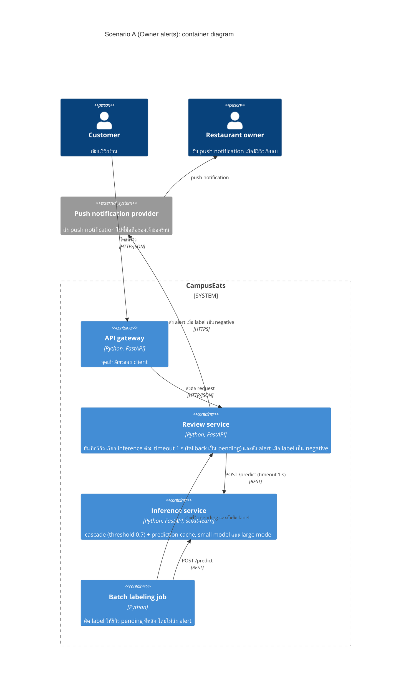

# Task 4: Deployment topologies and trade-offs

**Name / ชื่อ: ชยพล กุลตานนท์**

**Student ID / รหัสนิสิต: 6631306021**

This is **individual work**: each student completes and submits their own copy, in their own fork.

*งานนี้เป็น**งานเดี่ยว** นิสิตแต่ละคนทำและส่งงานของตัวเอง ใน fork ของตัวเอง*

**Scenario (A, B or C) / Scenario ที่เลือก: A (Owner alerts)**

Choose **one** scenario below. If the last digit of your student ID is odd, take A or B; if it is even, take B or C. Use your measurements from Tutorial 6 as evidence: cite run names from `results/runs.csv`. Answer in Thai or English.

เลือก scenario **หนึ่ง** ข้อด้านล่าง ถ้าเลขตัวสุดท้ายของรหัสนิสิตเป็นเลขคี่ ให้เลือก A หรือ B ถ้าเป็นเลขคู่ ให้เลือก B หรือ C ใช้ผลการวัดจาก tutorial ที่ทำไปเป็นข้อมูลอ้างอิง โดยอ้างชื่อ run จาก `results/runs.csv` จะตอบเป็นภาษาไทยหรือภาษาอังกฤษก็ได้

Facts that hold in every scenario / ข้อเท็จจริงที่ใช้กับทุก scenario:

- The large model serves at most **20 calls per second** (4 calls at once × about 200 ms each), and every call costs money.

  *large model รับได้สูงสุด **20 calls ต่อวินาที** (พร้อมกัน 4 calls × ประมาณ 200 ms ต่อ call) และทุก call มีค่าใช้จ่าย*
- The small model is fast and cheap enough to run anywhere, including inside the review service or on a kiosk, but it is much less accurate on its own.

  *small model เร็วและถูกพอที่จะรันที่ไหนก็ได้ รวมถึงภายใน review service หรือบน kiosk แต่ถ้าใช้ตัวเดียวจะแม่นน้อยกว่ามาก*

## Scenarios

**A. Owner alerts.** When a customer posts a negative review, the restaurant owner gets a push notification within **2 seconds**. At the lunch peak, CampusEats receives **40 reviews per second**. A missed alert is acceptable, but a wrong alert (for example, "your customer is unhappy" when they are happy) makes owners stop trusting alerts and, in the end, ignore them.

*เมื่อลูกค้าโพสต์รีวิวเชิงลบ เจ้าของร้านจะต้องได้รับ push notification ภายใน **2 วินาที** เวลาช่วงพีคตอนเที่ยง CampusEats ได้รับรีวิวจำนวน **40 รายการต่อวินาที** การพลาด alert ไปบ้างนั้นยอมรับได้ แต่ alert ที่ผิด (เช่น "ลูกค้าไม่พอใจ" ทั้งที่จริงๆ แล้วพอใจ) จะทำให้เจ้าของร้านไม่เชื่อถือและเลิกสนใจ alert ในที่สุด*

**B. Canteen kiosk.** A tablet in each canteen lets students leave a review on the spot. However, the canteen Wi-Fi is poor: the tablets lose their connection several times a day, for minutes at a time. The system must accept every review, even while a tablet is offline. Restaurant owners need the labels **by the end of the day**.

*มี tablet ในแต่ละโรงอาหารให้นิสิตรีวิวได้ทันที อย่างไรก็ดี การเชื่อมต่อ Wi-Fi ในโรงอาหารไม่ดี ทำให้ tablet หลุดการเชื่อมต่อวันละหลายครั้ง ครั้งละหลายนาที ระบบจะต้องรับรีวิวได้ทุกรายการแม้ขณะที่กำลัง offline อยู่ และเจ้าของร้านต้องการ label **ภายในสิ้นวัน***

**C. Weekly report.** Restaurant owners want a weekly sentiment report. Nothing in producing this report has to be real-time. **Accuracy matters most** and **cost must be minimal**.

*เจ้าของร้านต้องการรายงาน sentiment รายสัปดาห์ ไม่มีอะไรที่จะต้องทำแบบ real-time ในการออกรายงานนี้ ความแม่นยำ **(accuracy) สำคัญที่สุด** และ **ค่าใช้จ่ายต้องน้อยที่สุด***

## Topologies and patterns to choose from / Topology และ pattern ที่เลือกใช้ได้

| | Topology | Where the model runs / โมเดลรันที่ไหน |
|---|---|---|
| T1 | Model as a service, synchronous | Inference service, called for each review (today's baseline) *inference service ถูกเรียกทุกรีวิว (baseline ของวันนี้)* |
| T2 | Model as a library | Inside the review service, or on the device *ภายใน review service หรือบนอุปกรณ์* |
| T3 | Hybrid | Small model locally, large model as a remote service *small model รันในเครื่อง large model เป็น remote service* |
| T4 | Asynchronous / batch | Reviews are queued (broker, W10) or stored, and scored later in bulk *รีวิวถูกเข้าคิว (broker, W10) หรือเก็บไว้ แล้วติด label ทีหลังเป็นชุด* |

Combine one topology with any of the patterns from Tutorial 6: **fallback**, **cascade** and **cache**.

*เลือก topology หนึ่งแบบ แล้วผสมกับ pattern จาก Tutorial 6 ได้ตามต้องการ: **fallback**, **cascade** และ **cache***

## 1. Quality requirements

The three most important quality requirements for your scenario, each with a number where possible.

*quality requirements ที่สำคัญที่สุด 3 ข้อของ scenario ที่เลือก ระบุตัวเลขเมื่อทำได้*

| # | Quality | Requirement |
|---|---|---|
| 1 | Performance (latency) | เจ้าของร้านได้รับ push notification ของรีวิวเชิงลบภายใน 2 วินาทีหลังลูกค้าโพสต์ ในช่วงพีค 40 รีวิวต่อวินาที |
| 2 | Capacity / Cost | ในช่วงพีค ระบบเรียก large model ได้ไม่เกิน 20 calls ต่อวินาที แปลว่ารีวิวที่ไปถึง large model ต้องไม่เกิน 50% (20 / 40) และควรน้อยที่สุดเพราะทุก call มีค่าใช้จ่าย |
| 3 | Accuracy | alert ที่ผิดต้องน้อยที่สุด ให้ label ถูกต้องสูงที่สุดเท่าที่ capacity ยอมให้ (อย่างน้อย 90% ตาม QR3 ของ CampusEats) ส่วนการพลาด alert ยอมรับได้ |

## 2. Design / การออกแบบ

Your topology, the patterns you add, and a container-level diagram (C4 level 2). The C4 diagram must be written in Mermaid.

*topology ที่เลือก pattern ที่เพิ่ม และ diagram ระดับ container (C4 level 2) เขียนด้วย Mermaid*

**Topology:** T1 Model as a service, synchronous

**Patterns:**
- **Cascade (threshold 0.7):** ถาม small model ก่อน และส่งไป large model เฉพาะรีวิวที่ small model ไม่มั่นใจ เพื่อลดจำนวน large calls
- **Cache:** รีวิวที่ข้อความซ้ำได้คำตอบจาก cache โดยไม่ต้องเรียกโมเดล ซึ่งช่วยให้ large calls ต่ำกว่า 20 calls ต่อวินาที
- **Fallback (timeout 1 วินาที):** ถ้า inference service ช้า ค้าง หรือ large model เต็ม รีวิวจะถูกบันทึกเป็น `pending` และไม่ส่ง alert ระบบจึงพลาด alert (ยอมรับได้) แทนที่จะส่ง alert ช้าหรือผิด รีวิว pending ให้ batch job มาติด label ทีหลังโดยไม่ส่ง alert ย้อนหลัง

## 3. Evidence / หลักฐาน

Which runs support your choice? Show the numbers and, for scenario A, the capacity arithmetic: how many large-model calls per second does your design need at the peak?

*run ไหนที่สนับสนุนการตัดสินใจของนิสิต ให้นิสิตแสดงตัวเลขประกอบ และสำหรับ scenario A ให้นิสิตแสดงการคำนวณ capacity ด้วย เพื่อแสดงว่าในช่วงพีคนั้น design ของนิสิตต้องใช้ large model กี่ calls ต่อวินาที*

| Run | What it shows / แสดงอะไร |
|---|---|
| `t0-large` | large model อย่างเดียว: large calls 100% → 40 × 1.00 = **40 calls/s** เกิน 20 calls/s สองเท่า จึงใช้ไม่ได้ในช่วงพีค |
| `t0-small` | small model อย่างเดียว: accuracy 72.5% (ผิดประมาณ 1 ใน 4) ทำให้เกิด alert ผิดมากเกินไป |
| `t2-0.7` | cascade ที่ 0.7 โดยไม่มี cache: large calls 53% → 40 × 0.53 = **21.2 calls/s** ยังเกิน 20 calls/s |
| `t3-cache-0.7` | cascade ที่ 0.7 + cache: large calls 38% → 40 × 0.38 = **15.2 calls/s** ผ่าน (เหลือ headroom 4.8 calls/s) โดย accuracy 93.0% และ p95 530 ms ซึ่งเหลือเวลาราว 1.5 s ใน budget 2 s สำหรับส่ง push notification |
| `t3-cache` | cascade ที่ 0.6 + cache: 40 × 0.31 = **12.4 calls/s** มี headroom มากกว่า แต่ accuracy 91.5% ต่ำกว่า 0.7 + cache จึงจะเกิด alert ผิดมากกว่า |
| `t1-after` | fallback: เมื่อ large model ค้าง 10% ของ calls ยังไม่มี error (0) และ p95 1010 ms ยังต่ำกว่า 2 s รีวิวที่ค้าง 28 รายการเป็น pending ซึ่งในการออกแบบนี้คือ alert ที่พลาด ไม่ใช่ alert ที่ผิด |

**Capacity arithmetic ที่ peak:** 40 reviews/s × 38% (large calls ของ `t3-cache-0.7`) = **15.2 large calls/s ≤ 20 calls/s**

## 4. ADR

Use the ADR format from W5.

*ใช้รูปแบบ ADR จาก W5*

**Title:** ใช้ inference service แบบ synchronous (T1) ร่วมกับ cascade (threshold 0.7), cache และ fallback สำหรับ owner alerts

**Status:** Proposed

**Context:** เจ้าของร้านต้องได้รับ alert ของรีวิวเชิงลบภายใน 2 วินาที ช่วงพีคมีรีวิว 40 รายการต่อวินาที แต่ large model รับได้สูงสุด 20 calls ต่อวินาทีและทุก call มีค่าใช้จ่าย alert ที่ผิดทำลายความเชื่อถือของเจ้าของร้าน ส่วน alert ที่พลาดยอมรับได้ ทางเลือกที่วัดผลแล้วมีดังนี้:
- large model ทุกรีวิว: accuracy 93.5% แต่ต้องใช้ 40 calls/s (`t0-large`) เกินขีดจำกัด
- small model อย่างเดียว: accuracy 72.5% (`t0-small`) ทำให้เกิด alert ผิดมากเกินไป
- cascade ที่ 0.7 ไม่มี cache: 21.2 calls/s (`t2-0.7`) ยังเกินขีดจำกัด
- cascade ที่ 0.7 + cache: 15.2 calls/s, accuracy 93.0% และ p95 530 ms (`t3-cache-0.7`) ผ่านทั้ง capacity และ latency ด้วย accuracy ใกล้กับ large model อย่างเดียว
- cascade ที่ 0.6 + cache: 12.4 calls/s แต่ accuracy 91.5% (`t3-cache`) ซึ่งจะเกิด alert ผิดมากกว่า
- เมื่อ large model ค้าง fallback ที่ timeout 1 s ทำให้ไม่มี error และ p95 1010 ms ยังอยู่ใน 2 s (`t1-after`)

**Decision:** ใช้ inference service แบบ synchronous (T1) ที่ทำ cascade ด้วย threshold 0.7 และมี prediction cache ส่วน review service เรียก inference ด้วย timeout 1 วินาที ถ้า timeout หรือ error ให้บันทึกรีวิวเป็น pending และไม่ส่ง alert แต่ถ้าได้ label negative ให้ส่ง push notification ทันที

**Consequences:**
- Positive:
  - ช่วงพีคใช้ large model ประมาณ 15.2 calls/s อยู่ในขีดจำกัด 20 calls/s และจ่ายค่า large model น้อยกว่าการใช้ large model ทุกรีวิว
  - เมื่อ inference service ช้าหรือค้าง ระบบจะพลาด alert แทนการส่ง alert ผิดหรือทำให้การโพสต์รีวิวล้มเหลว
- Negative / สิ่งที่ต้องเตรียม:
  - ต้อง monitor cache hit rate และจำนวน large calls ต่อวินาทีในช่วงพีค เพราะถ้าไม่มี cache จะเกินขีดจำกัด ถ้ารีวิวจริงซ้ำกันน้อยกว่าที่วัดได้ (35%) large model จะเต็ม และรีวิวส่วนเกินจะ timeout จนพลาด alert
  - ยังมี alert ผิดจากรีวิวที่ small model ตอบผิดแต่มั่นใจ (เช่น ประโยคปฏิเสธ) จึงต้องเก็บ feedback จากเจ้าของร้านเพื่อปรับ threshold ต่อ
  - ต้องมี batch labeling job สำหรับรีวิว pending และเชื่อมต่อกับ push notification provider
  - ทุกครั้งที่ deploy โมเดลใหม่ต้อง invalidate cache

**Alternatives considered:** at least one topology you rejected, and why.

*อย่างน้อยหนึ่ง topology ที่ไม่เลือก และเหตุผล*

> - **T1 ที่ใช้ large model ทุกรีวิว:** แม่นที่สุด (93.5%) แต่ต้องใช้ 40 calls/s ซึ่งเกินขีดจำกัด 20 calls/s (`t0-large`)
> - **T2 Model as a library (small model ใน review service อย่างเดียว):** เร็วและไม่มีค่าใช้จ่ายของ large model แต่ accuracy 72.5% (`t0-small`) จะทำให้เกิด alert ผิดจนเจ้าของร้านเลิกเชื่อ alert
> - **T4 Asynchronous / batch:** ติด label ทีหลังเป็นชุด จึงไม่ทันส่ง alert ภายใน 2 วินาที
> - **T3 Hybrid (small model ใน review service, large model เป็น remote service):** ใช้ cascade แบบเดียวกันได้และไม่ต้องเรียกผ่าน network สำหรับรีวิวที่ small model ตอบเอง แต่ยังไม่มีผลวัดของ topology นี้ และการแยกโมเดลไว้ใน service เดียวทำให้ update โมเดลได้โดยไม่ต้อง deploy review service ใหม่ (lecture: "models deployed as independent services")
